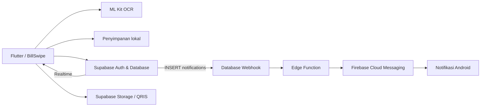

<p align="center">
  
</p>

<h1 align="center">BillSwipe</h1>
<p align="center">Bagi tagihan dari struk, hubungkan teman, dan pantau pembagian dalam satu aplikasi.</p>
<p align="center">
  
  
  
  
</p>

## Tentang proyek

**BillSwipe** adalah aplikasi Flutter untuk membantu membagi tagihan makan bersama. Pengguna mengambil foto struk atau memasukkan item secara manual, menentukan pemilik setiap item, lalu membagi pajak, biaya layanan, dan diskon secara proporsional.

Proyek portofolio ini mencakup antarmuka mobile, pengolahan hasil OCR, perhitungan rupiah tanpa pecahan, autentikasi, relasi pertemanan dengan persetujuan, penyimpanan lokal, serta integrasi backend dan notifikasi.

**Platform utama yang sudah dijalankan: Android.** Proyek juga menyertakan konfigurasi iOS dan web, dengan batas dukungan yang dijelaskan di bawah.

## Fitur

| Fitur | Penjelasan |
| --- | --- |
| Foto struk & OCR | Kamera/galeri, crop di dalam Flutter, dan pengenalan teks menggunakan Google ML Kit. Hasil dapat diperbaiki secara manual. |
| Editor tagihan | Tambah, ubah, atau hapus item; atur pajak, layanan, dan diskon. |
| Pembagian per orang | Tetapkan satu pemilik untuk setiap item. Biaya tambahan dibagi proporsional. |
| Perhitungan rupiah | Menggunakan bilangan bulat dan alokasi sisa pembulatan agar total bagian sesuai tagihan. |
| Akun | Login email/password, pendaftaran dan konfirmasi email melalui OTP, serta alur Google OAuth yang memerlukan konfigurasi provider. |
| Pertemanan | Kode teman, permintaan pertemanan, dan persetujuan penerima sebelum mengirim tagihan. |
| Tagihan teman | Kirim nominal ke teman yang terhubung; permintaan memakai referensi unik untuk mencegah duplikasi. |
| QRIS per akun | Unggah gambar QRIS, lihat instruksi pembayaran, dan salin nominal. |
| Riwayat | Simpan snapshot pembagian, lihat rincian peserta/item, dan filter tagihan online berdasarkan arah serta status. |
| Kotak masuk | Lonceng dengan jumlah belum dibaca, pembaruan melalui Realtime, dan tandai notifikasi dibaca. |
| Push Android | Integrasi Firebase Cloud Messaging, registrasi perangkat, dan Edge Function untuk pengiriman dari webhook database. Memerlukan konfigurasi server. |
| Mode tanpa akun | Pembagian lokal dapat digunakan tanpa login atau backend. |

> **Status pembayaran:** QRIS pada aplikasi berupa gambar statis. Pembayaran dilakukan melalui aplikasi bank/e-wallet. BillSwipe belum memverifikasi pembayaran otomatis dan tidak mengubah status menjadi lunas melalui tombol pengguna.

## Alur penggunaan

1. Masuk ke akun atau pilih mode tanpa akun.
2. Ambil foto struk, pilih gambar, atau isi item manual.
3. Periksa nama/harga item dan biaya tambahan.
4. Tambahkan peserta atau pilih teman yang telah menerima pertemanan.
5. Tentukan pemilik setiap item dan lihat total masing-masing.
6. Simpan pembagian ke riwayat; kirim tagihan ke teman jika menggunakan akun.
7. Pantau tagihan dan notifikasi melalui riwayat serta ikon lonceng.

## Teknologi & arsitektur

| Bagian | Teknologi |
| --- | --- |
| Aplikasi | Flutter, Dart, Material 3 |
| OCR | Google ML Kit Text Recognition |
| Gambar | image_picker, file_selector, crop_your_image |
| Data lokal | path_provider dan shared_preferences |
| Backend | Supabase Auth, PostgreSQL, Row Level Security, RPC, Storage, Realtime |
| Push | Firebase Cloud Messaging + Supabase Edge Function (TypeScript/Deno) |
| Pengujian | flutter_test untuk logika dan widget |



## Menjalankan proyek

### Prasyarat

- Flutter dengan **Dart >= 3.13.3** sesuai `pubspec.yaml`.
- Android SDK dan perangkat dengan USB debugging atau emulator. Minimum Android API 24.
- VS Code dengan ekstensi Flutter/Dart, atau IDE Flutter lain.
- Untuk build iOS: macOS, Xcode, dan CocoaPods; target minimum iOS 15.5. Build iOS belum diverifikasi pada proyek ini.

Versi lingkungan pengembangan: Flutter **3.47.4**, Dart **3.13.3**.

### 1. Clone & ambil dependencies

```bash
git clone https://github.com/duhaalul/billswipe.git
cd billswipe
flutter pub get
flutter doctor
```

### 2. Coba tanpa backend

```bash
flutter run
```

Pilih **Gunakan tanpa akun**. Fitur teman, tagihan online, dan notifikasi memerlukan konfigurasi backend.

### 3. Hubungkan Supabase

Salin `config.example.json` menjadi `config.local.json`:

```powershell
# PowerShell
Copy-Item config.example.json config.local.json
```

```bash
# macOS / Linux
cp config.example.json config.local.json
```

Isi `SUPABASE_URL` dan `SUPABASE_ANON_KEY` dengan URL proyek serta **publishable/anon key** milik Anda. Jalankan migration pertama dan konfigurasi Auth/Storage sesuai [panduan Supabase](SUPABASE_SETUP.md).

```bash
flutter run --dart-define-from-file=config.local.json
```

Konfigurasi F5 pada `.vscode/launch.json` juga menggunakan file tersebut. Google login membutuhkan OAuth Client ID/Secret di dashboard Supabase; OTP memerlukan template email dan layanan SMTP.

### 4. Aktifkan push Android (opsional)

Ikuti [panduan Firebase & push](PUSH_SETUP.md): daftarkan package `com.billswipe.billswipe`, atur konfigurasi client, jalankan migration perangkat, deploy Edge Function, isi secrets, dan buat webhook pada INSERT tabel `notifications`.

Setelah build ulang, buka **Lonceng → Aktifkan notifikasi HP** dan izinkan notifikasi Android. Source integrasi tersedia; keberhasilan notifikasi saat aplikasi ditutup harus diuji pada perangkat dan konfigurasi server masing-masing.

### 5. Coba di Chrome

```bash
flutter run -d chrome --web-port=7357 --dart-define-from-file=config.local.json
```

Chrome mendukung gambar sebagai acuan input manual. OCR/crop khusus mobile; push web belum dikonfigurasi. Riwayat menggunakan penyimpanan browser, sedangkan draf dan gambar pada sesi web tidak bertahan setelah reload. Build web sebelumnya berhasil, tetapi pengujian interaksi Chrome belum selesai diverifikasi.

## Struktur proyek

```text
lib/
  main.dart                    # Alur foto, editor, pembagian, dan hasil
  bill.dart                    # Model dan perhitungan proporsional
  receipt_parser.dart          # Parser teks struk
  receipt_crop_page.dart       # Crop gambar
  input_dialog.dart            # Dialog input
  history_store.dart           # Snapshot lokal per akun
  history_page.dart            # Riwayat pembagian dan tagihan online
  social/
    backend.dart               # Inisialisasi Supabase dan OAuth
    account_gate.dart          # Login/daftar dan navigasi akun
    email_confirmation.dart    # Verifikasi dan kirim ulang OTP
    social_page.dart           # Teman, tagihan, dan QRIS
    notifications.dart         # Lonceng dan kotak masuk
    push_service.dart          # Registrasi token FCM dan pembukaan notifikasi
supabase/
  migrations/                  # Skema, RLS, RPC, dan perangkat push
  functions/send-push/          # Pengiriman FCM dari webhook
  templates/                   # Template email OTP
assets/                        # Logo dan ikon
android/  ios/  web/            # Proyek platform
test/                         # Tes logika dan widget
tool/                         # Konfigurasi Firebase dan render logo
```

## Pengujian

```bash
flutter analyze
flutter test
```

Pengujian mencakup:

- Parsing harga dan penyaringan metadata struk; parser berhenti pada total.
- Rekonsiliasi pembagian pajak, layanan, diskon, dan sisa rupiah.
- Penyimpanan ID tagihan serta relasi peserta dengan akun.
- Riwayat: snapshot tidak berubah saat draf diedit, pembaruan tanpa duplikasi, pemisahan akun, dan penyimpanan berurutan.
- Validasi input OTP serta perilaku dialog/crop.

Pada pemeriksaan lokal terakhir: **12 tes lolos**, satu tes khusus Chrome dilewati pada VM, dan analisis kode bersih. Tes unit/widget tidak menggantikan pengujian email, OAuth, RLS lintas akun, atau pengiriman FCM pada layanan nyata.

## Data & keamanan

- RLS membatasi akses tabel sesuai akun dan hubungan pertemanan.
- Permintaan teman dan tagihan diproses melalui RPC yang memeriksa identitas pengguna.
- Gambar QRIS berada di bucket privat; akses mengikuti aturan backend.
- Client tidak diberi izin mengubah status pembayaran menjadi `paid`.
- Edge Function memeriksa `x-push-secret` sebelum mengirim notifikasi.
- Konfigurasi lokal, token webhook, service account, dan kredensial tidak disertakan di Git.
- Riwayat pembagian tersimpan **lokal per akun**, bukan sinkronisasi penuh antarperangkat. Menghapus data aplikasi/browser menghapus riwayat lokal.

## Batas pengembangan saat ini

- Akurasi OCR bergantung pada foto dan format struk. Hasil tetap perlu diperiksa; tidak ada klaim akurasi terukur.
- Satu item hanya memiliki satu pemilik; pembagian satu item ke beberapa orang belum tersedia.
- Konfirmasi pembayaran otomatis, QRIS dinamis, dan integrasi payment gateway belum tersedia.
- Push Android memerlukan konfigurasi lengkap dan pengujian penerimaan. Push iOS/APNs dan web belum disiapkan.
- Pengiriman push bersifat best-effort; antrean retry otomatis belum tersedia. Kotak masuk Supabase tetap menyimpan notifikasi.
- Distribusi saat pengembangan memakai build debug. Penandatanganan release dan publikasi Play Store belum dilakukan.

## Pengembang

Dikembangkan sebagai proyek portofolio oleh **[Duha Alul Bariq](https://github.com/duhaalul)**.
